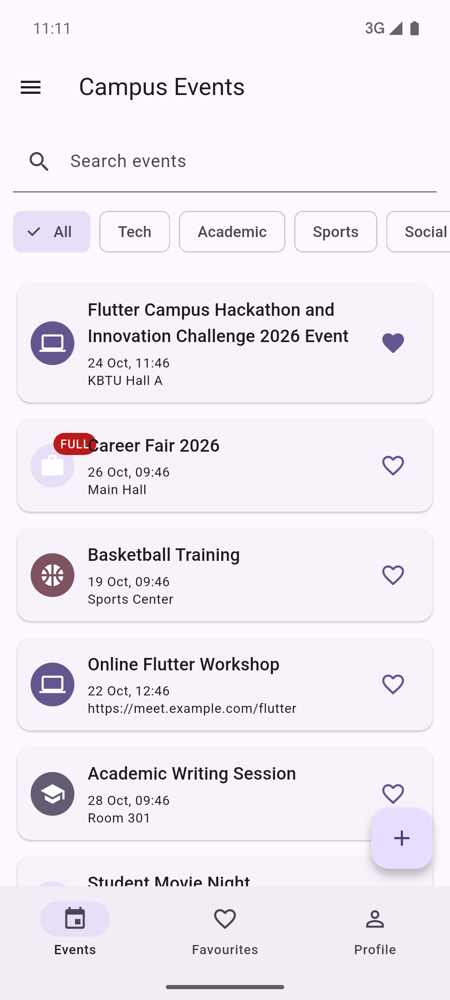
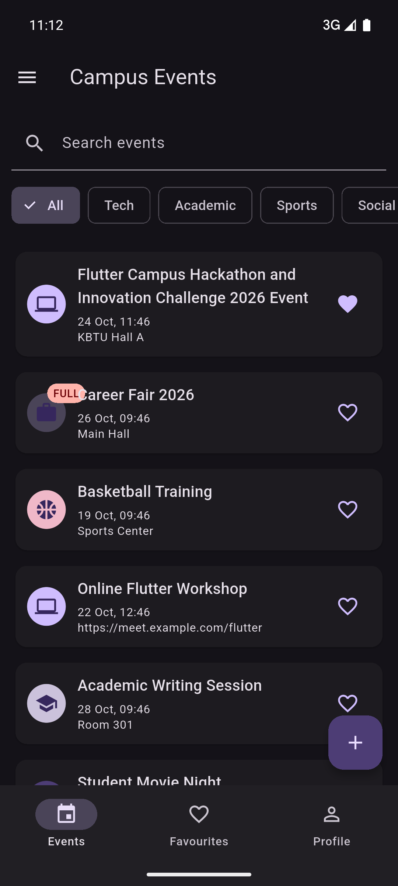
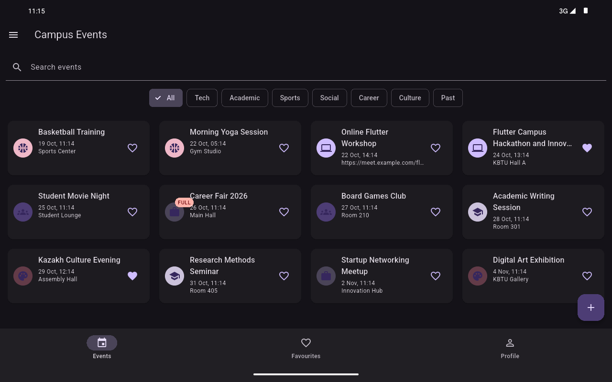

# Campus Events

## Domain

Campus Events is a Flutter application for university students.

The app allows students to browse campus events, search and filter them, add events to favourites, register for events, create new events, edit existing events, and manage their profile.

All application data is stored in memory.

## Screenshots

### Phone - Light Theme

### Phone - Dark Theme

### Tablet - Grid Layout

## Decisions

I chose the Campus Events domain because it fits the required data model and user actions well.
The application uses three main tabs: Events, Favourites, and Profile.
The event list changes from a normal list to a grid when the screen width is at least 600 pixels.
The event model is immutable and changes are made by creating updated copies.
The Shell screen stores the event list and profile so the tabs receive data through constructors and callbacks.
The same event form is used for both creating and editing events.
The application supports System, Light, and Dark themes using ColorScheme.fromSeed.
No external packages are used for the application logic.